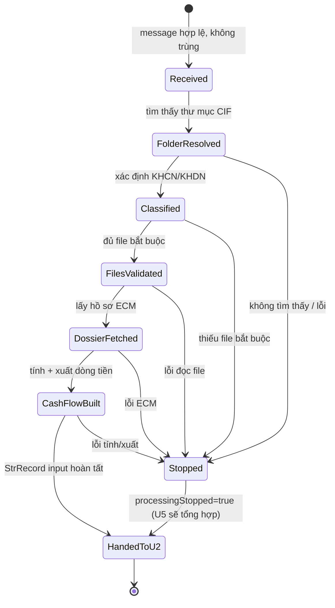
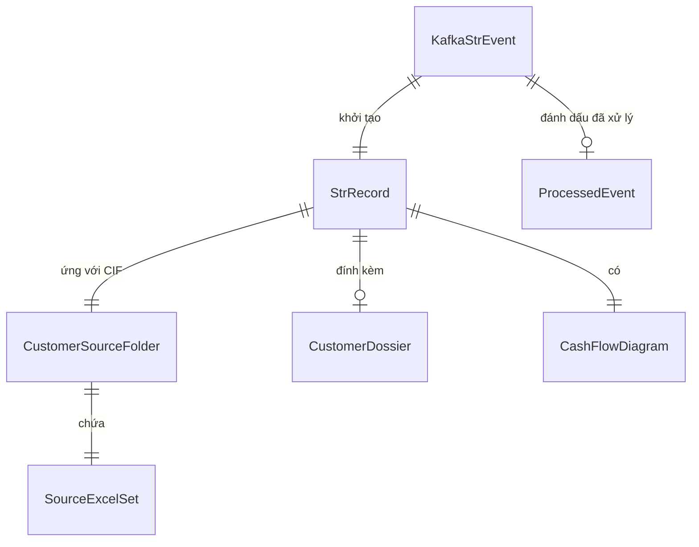

# Functional Spec — U1 ConsumeData

Đặc tả hành vi của cấu phần U1. Đây là nguồn chân lý cho workflow và state machine
của U1; ER diagram và rules summary bên dưới là view dẫn xuất.

## Workflow chính — xử lý một message (một CIF)

1. Nhận message từ topic `RPA_STR_NHNN_INPUT`.
2. Kiểm tra hợp lệ (BR1.1): sai → log, bỏ qua, tiếp message kế.
3. Chống trùng (BR1.2): eventID đã xử lý → bỏ qua.
4. Khởi tạo `StrRecord` với CIF, processingStopped=false.
5. Xác định thư mục CIF theo ngày hiện tại (quét /Users/hainguyen/Projects/RPA/AMLD/YYYYMM/YYYYMMDD, khớp CIF).
6. Xác định loại KH theo file hiện diện (BR1.3).
7. Kiểm đủ file excel bắt buộc (BR1.4): thiếu → ghi lỗi, processingStopped=true, sang bước 12.
8. Đọc 5 file excel vào SourceExcelSet; trích các cột input của StrRecord (TENKHACHHANG, MASOTHUE, số liệu người lập, các cột Phần IV/V...).
9. Lấy hồ sơ PDF qua ECM mock, thử lần lượt business_code (BR1.5): lỗi/thiếu hồ sơ bắt buộc → ghi BOT_ECM lỗi, processingStopped=true, sang bước 12.
10. Tính số liệu dòng tiền (BR1.6) và điền vào StrRecord (SOLUONG/SOTIEN vào/ra).
11. Xuất `Minh Họa Dòng Tiền.pdf` (BR1.8).
12. Ghi eventID vào ProcessedEvent (đánh dấu đã xử lý).
13. Chuyển `StrRecord` (và các file đính kèm) sang cấu phần kế (U2).

## State machine — StrRecord trong phạm vi U1

## ER diagram (derived từ entities.md)

## Rules summary (derived từ rules.md)

| ID | Loại | Nội dung |
|---|---|---|
| BR1.1 | validation | Message hợp lệ |
| BR1.2 | policy | Chống trùng eventID |
| BR1.3 | calculation | Xác định loại KH |
| BR1.4 | validation | Đủ file bắt buộc |
| BR1.5 | policy | Lấy hồ sơ ECM |
| BR1.6 | calculation | Tính dòng tiền |
| BR1.7 | policy | Lỗi → dừng record |
| BR1.8 | constraint | Xuất PDF dòng tiền |

## Business scenarios

- **Happy path (KHCN):** message hợp lệ → đủ file cá nhân → ECM trả hồ sơ → tính
  dòng tiền → xuất PDF → StrRecord input đầy đủ → chuyển U2.
- **Happy path (KHDN):** như trên nhưng dùng file tổ chức + có MASOTHUE.
- **Thiếu file:** thiếu bang_ke → processingStopped=true, BOT_GHICHU ghi tên file
  thiếu, chuyển thẳng U5.
- **Lỗi ECM:** ECM timeout → BOT_ECM lỗi, processingStopped=true.
- **Message trùng:** eventID đã xử lý → bỏ qua, không tạo StrRecord mới.
