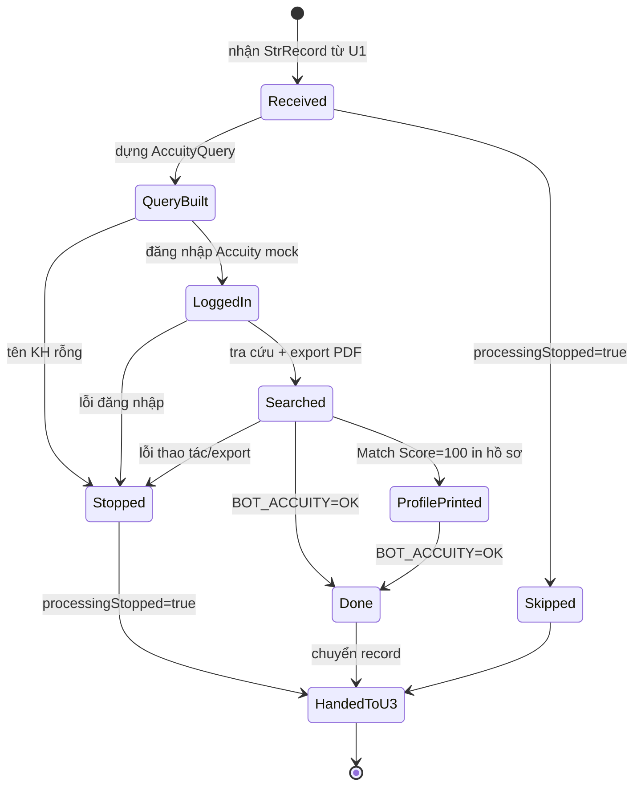
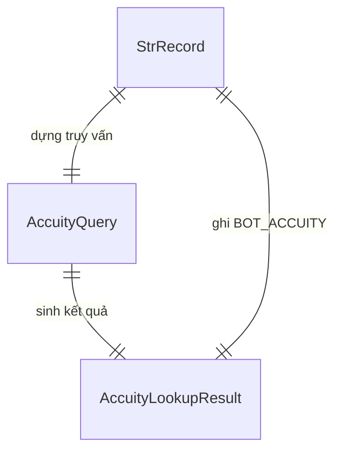

# Functional Spec — U2 DataEntryAccuity

Đặc tả hành vi của cấu phần U2. Đây là nguồn chân lý cho workflow và state machine
của U2; ER diagram và rules summary bên dưới là view dẫn xuất.

## Workflow chính — tra cứu Accuity cho một CIF

1. Nhận `StrRecord` từ U1.
2. Nếu `processingStopped = true` (BR2.1): bỏ qua, trả nguyên record cho U3.
3. Dựng `AccuityQuery` (BR2.2): entityType theo `LOAIKHACHHANG`, searchName =
   `TENKHACHHANG`, searchMode = Single.
4. Nếu `TENKHACHHANG` rỗng: ghi lỗi tra cứu (BR2.5), `processingStopped=true`,
   sang bước 9.
5. Đăng nhập web Accuity mock (credentials từ `data/config.yaml`, BR2.7) và tra
   cứu (BR2.3).
6. Export kết quả ra `Tra cứu Accuity.pdf`.
7. Nếu Match Score = 100 (BR2.4): mở bản ghi và print hồ sơ ra
   `Tra cứu Accuity(n).pdf`.
8. Ghi `BOT_ACCUITY = OK` (BR2.6).
9. (Khi lỗi) ghi `BOT_ACCUITY` lỗi + `BOT_GHICHU`, đặt `processingStopped=true`
   (BR2.5).
10. Chuyển `StrRecord` (đã cập nhật) sang cấu phần kế (U3).

## State machine — StrRecord trong phạm vi U2

## ER diagram (derived từ entities.md)

## Rules summary (derived từ rules.md)

| ID | Loại | Nội dung |
|---|---|---|
| BR2.1 | policy | Bỏ qua record đã dừng |
| BR2.2 | calculation | Entity Type theo loại KH |
| BR2.3 | policy | Đăng nhập + tra cứu + export PDF |
| BR2.4 | policy | Match Score 100 → in thêm hồ sơ |
| BR2.5 | policy | Lỗi tra cứu → dừng record |
| BR2.6 | constraint | Ghi BOT_ACCUITY khi thành công |
| BR2.7 | constraint | Không hardcode credentials Accuity |

## Business scenarios

- **Happy path (KHCN):** record OK → entityType=Individual → tra cứu → export
  `Tra cứu Accuity.pdf` → BOT_ACCUITY=OK → chuyển U3.
- **Happy path (KHDN):** như trên nhưng entityType=Organization.
- **Match Score 100:** sau khi export, mở bản ghi và print thêm
  `Tra cứu Accuity(1..n).pdf`.
- **Lỗi đăng nhập Accuity:** ghi BOT_ACCUITY lỗi + địa chỉ web, processingStopped
  =true, chuyển thẳng U5.
- **Record đã dừng từ U1:** U2 bỏ qua, chuyển nguyên record.
