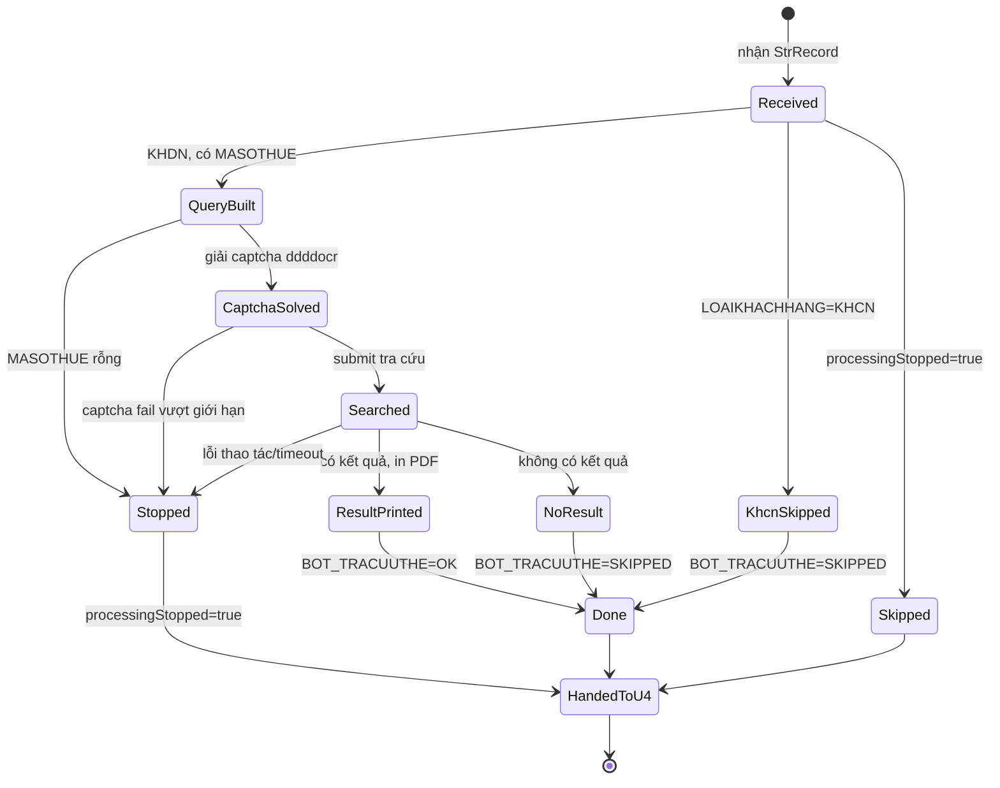
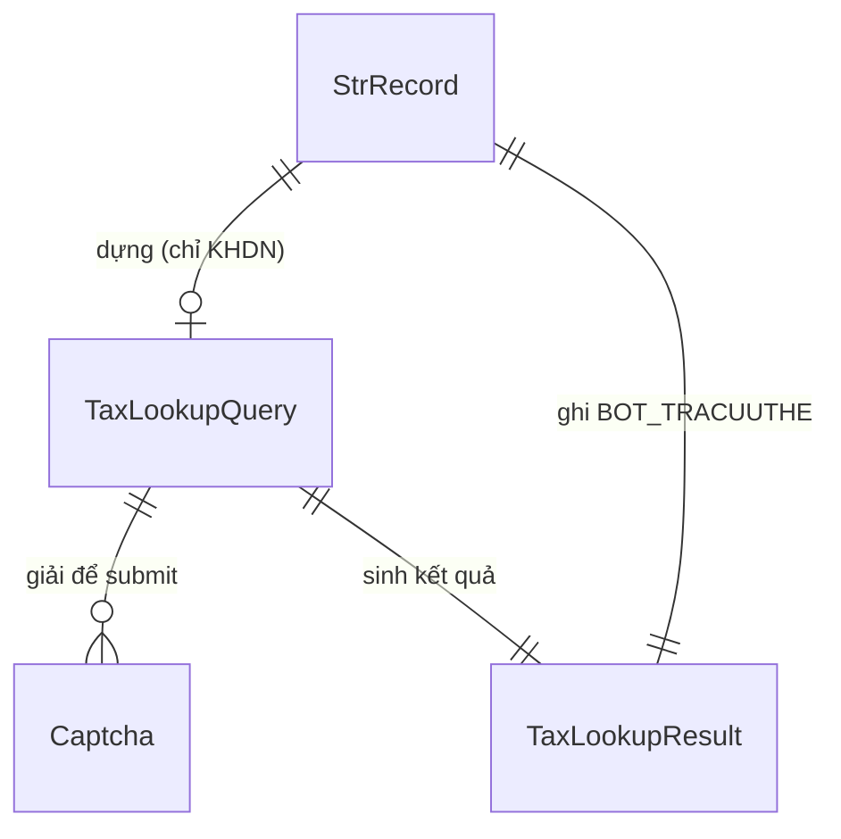

# Functional Spec — U3 DataEntryTraCuuThue

Đặc tả hành vi của cấu phần U3. Đây là nguồn chân lý cho workflow và state machine
của U3; ER diagram và rules summary bên dưới là view dẫn xuất.

## Workflow chính — tra cứu Cục Thuế cho một CIF

1. Nhận `StrRecord` từ U1 (hoặc từ nhánh song song U2 khi hợp nhất).
2. Nếu `processingStopped = true` (BR3.1): bỏ qua, trả nguyên record cho U4.
3. Nếu `LOAIKHACHHANG = KHCN` (BR3.2): ghi `BOT_TRACUUTHE = SKIPPED`, sang bước 9.
4. Dựng `TaxLookupQuery` với `taxCode = MASOTHUE`; nếu `MASOTHUE` rỗng: lỗi
   (BR3.6), sang bước 10.
5. Mở web Cục Thuế thật (cấu hình từ `data/config.yaml`, BR3.7), nhập mã số thuế.
6. Lấy ảnh captcha, giải bằng ddddocr (BR3.3); giải sai thì thử lại trong giới
   hạn số lần; vượt giới hạn → lỗi (BR3.6).
7. Submit tra cứu.
8. Nếu có kết quả (BR3.4): print `Tra cứu tình trạng người nộp thuế.pdf`,
   `BOT_TRACUUTHE = OK`; nếu không có: `BOT_TRACUUTHE = SKIPPED`.
9. (SKIPPED/OK) ghi `BOT_TRACUUTHE` (BR3.5).
10. (Khi lỗi) ghi `BOT_TRACUUTHE` lỗi + `BOT_GHICHU`, đặt `processingStopped=true`
    (BR3.6).
11. Chuyển `StrRecord` (đã cập nhật) sang cấu phần kế (U4).

## State machine — StrRecord trong phạm vi U3

## ER diagram (derived từ entities.md)

## Rules summary (derived từ rules.md)

| ID | Loại | Nội dung |
|---|---|---|
| BR3.1 | policy | Bỏ qua record đã dừng |
| BR3.2 | policy | Chỉ tra cứu khi KHDN |
| BR3.3 | policy | Nhập MST + giải captcha ddddocr |
| BR3.4 | policy | Có kết quả → in PDF; không có → bỏ qua |
| BR3.5 | constraint | Ghi BOT_TRACUUTHE |
| BR3.6 | policy | Lỗi tra cứu → dừng record |
| BR3.7 | constraint | Không hardcode credentials Cục Thuế |

## Business scenarios

- **KHCN:** U3 bỏ qua tra cứu, ghi `BOT_TRACUUTHE = SKIPPED`, chuyển U4.
- **KHDN có kết quả:** nhập MST → giải captcha → submit → có kết quả → print PDF
  → `BOT_TRACUUTHE = OK`.
- **KHDN không có kết quả:** tra cứu xong nhưng rỗng → `BOT_TRACUUTHE = SKIPPED`,
  không in PDF, không lỗi.
- **Captcha fail:** giải sai vượt giới hạn → lỗi, `processingStopped=true`,
  chuyển thẳng U5.
- **Record đã dừng từ U1/U2:** U3 bỏ qua, chuyển nguyên record.
