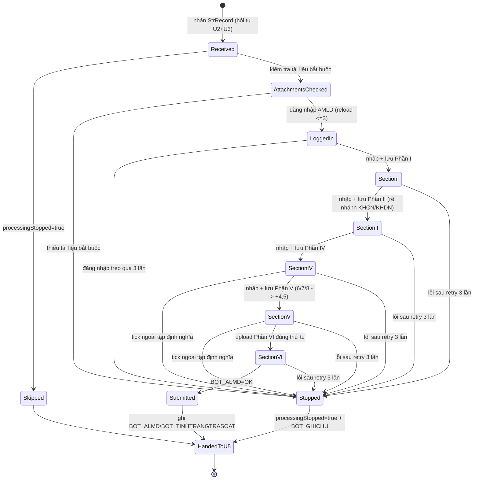
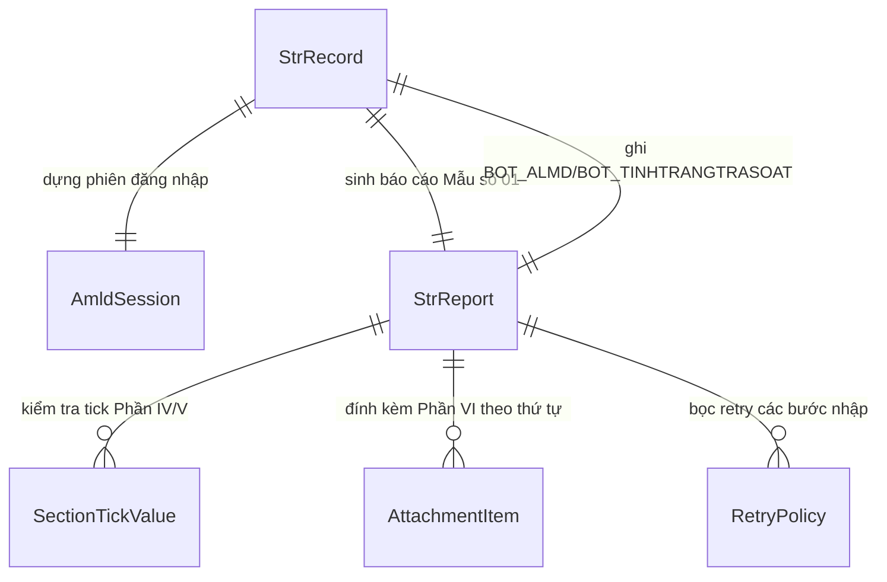

# Functional Spec — U4 DataEntryAMLD

Đặc tả hành vi của cấu phần U4. Đây là nguồn chân lý cho workflow và state machine
của U4; ER diagram và rules summary bên dưới là view dẫn xuất. U4 là điểm hội tụ
của hai nhánh tra cứu U2 (Accuity) và U3 (Cục Thuế).

## Workflow chính — nhập Mẫu số 01 trên AMLD Portal cho một CIF

1. Nhận `StrRecord` sau khi U2 và U3 đã bồi đắp (điểm hội tụ pipeline).
2. Nếu `processingStopped = true` (BR4.1): bỏ qua nhập, chuyển nguyên record cho U5.
3. Kiểm tra đủ tài liệu bắt buộc cho Phần VI — Bảng kê, Minh Họa Dòng Tiền.pdf,
   Hồ sơ mở tài khoản (BR4.7). Thiếu → ghi lỗi, `processingStopped=true`, sang bước 13.
4. Dựng `AmldSession` với `username = USER_ID_NGUOI_LAP_BAO_CAO`, password/endpoint
   từ `data/config.yaml` (BR4.11). Đăng nhập AMLD Portal thật.
5. Nếu màn hình đăng nhập treo (BR4.9): reload và đăng nhập lại; tối đa 3 lần. Quá
   3 lần → lỗi, `processingStopped=true`, sang bước 13.
6. Vào tab "Nhập STR" → "Mẫu số 01". Nhập theo thứ tự I → II → IV → V → VI,
   KHÔNG điền Phần III (BR4.2). Mỗi bước nhập được bọc retry ≤ 3 lần (BR4.8).
7. **Phần I (ĐTBC):** nhập thông tin đối tượng báo cáo theo mapping, lưu, xác nhận popup.
8. **Phần II:** rẽ nhánh theo `LOAIKHACHHANG` (BR4.3) — KHCN upload
   `ca_nhan_thuc_hien_giao_dich.xlsx` và tick "Trùng với cá nhân thực hiện";
   KHDN upload `to_chuc_thuc_hien_giao_dich.xlsx` và chọn người đại diện có GTTT
   ngày cấp mới nhất; lưu.
9. **Phần IV:** với mỗi giá trị tick, kiểm tra thuộc tập định nghĩa (BR4.6); nếu
   ngoài tập → dừng luồng KH, email lỗi (bước 13). Nhập loại báo cáo, dấu hiệu
   đáng ngờ, trạng thái/thời gian GD, tổng tiền nguyên tệ, upload bảng dòng tiền,
   mô tả lý do/cơ sở nghi ngờ/loại tội phạm; lưu.
10. **Phần V:** kiểm tra giá trị tick thuộc tập định nghĩa (BR4.6); nếu tập tick
    chứa ít nhất một trong 6/7/8 thì mặc định tick thêm 4 và 5 (BR4.5); lưu.
11. **Phần VI:** upload tài liệu đúng thứ tự Bảng kê → Minh Họa Dòng Tiền → Hồ sơ
    mở tài khoản → Hồ sơ KH → Tài liệu khác (BR4.4); đếm đúng số trang.
12. Ghi `BOT_ALMD = OK`, `BOT_TINHTRANGTRASOAT` (BR4.10); chuyển record cho U5.
13. (Khi lỗi) ghi `BOT_ALMD` lỗi + `BOT_GHICHU` + `BOT_TINHTRANGTRASOAT`, đặt
    `processingStopped=true`; chuyển record cho U5 để gửi email FAIL.

## State machine — StrRecord/StrReport trong phạm vi U4

## ER diagram (derived từ entities.md)

## Rules summary (derived từ rules.md)

| ID | Loại | Nội dung |
|---|---|---|
| BR4.1 | policy | Bỏ qua record đã dừng |
| BR4.2 | policy | Nhập I→II→IV→V→VI, bỏ Phần III |
| BR4.3 | policy | Phần II rẽ nhánh KHCN/KHDN |
| BR4.4 | constraint | Upload Phần VI đúng thứ tự |
| BR4.5 | calculation | Phần V: 6/7/8 kéo theo 4 và 5 |
| BR4.6 | validation | Chặn giá trị tick ngoài tập định nghĩa |
| BR4.7 | validation | Thiếu tài liệu bắt buộc → không nộp, email FAIL |
| BR4.8 | policy | Retry mỗi bước lỗi ≤ 3 lần |
| BR4.9 | policy | Đăng nhập treo → reload ≤ 3 lần |
| BR4.10 | constraint | Ghi BOT_ALMD/BOT_TINHTRANGTRASOAT |
| BR4.11 | constraint | Không hardcode credentials AMLD |

## Business scenarios

- **Happy path (KHCN):** record OK → kiểm tra đủ tài liệu → đăng nhập → Phần I →
  Phần II (upload file cá nhân, tick "Trùng với cá nhân thực hiện") → Phần IV →
  Phần V → Phần VI đúng thứ tự → `BOT_ALMD = OK` → chuyển U5.
- **Happy path (KHDN):** như trên nhưng Phần II upload file tổ chức và chọn người
  đại diện có GTTT ngày cấp mới nhất.
- **Phần V có 6/7/8:** khi tick chứa 6/7/8, robot tự tick thêm 4 và 5 trước khi lưu.
- **Tick ngoài định nghĩa:** gặp giá trị tick lạ ở Phần IV/V → dừng luồng KH,
  `processingStopped=true`, email lỗi.
- **Thiếu tài liệu bắt buộc:** thiếu Bảng kê/Minh Họa Dòng Tiền.pdf/Hồ sơ mở tài
  khoản → không nộp, email FAIL.
- **Đăng nhập treo:** reload + đăng nhập lại; quá 3 lần → lỗi, email lỗi.
- **Bước nhập lỗi tạm thời:** retry ≤ 3 lần; thành công thì tiếp tục, vẫn lỗi sau
  3 lần → dừng luồng KH, email báo thất bại.
- **Record đã dừng từ U1/U2/U3:** U4 bỏ qua nhập, chuyển nguyên record cho U5.
