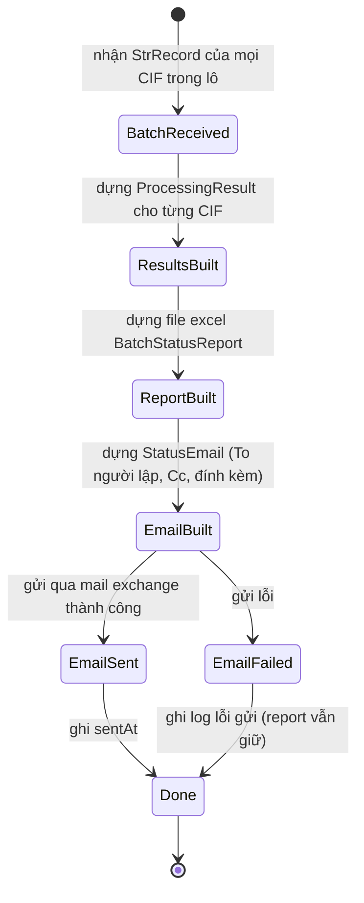
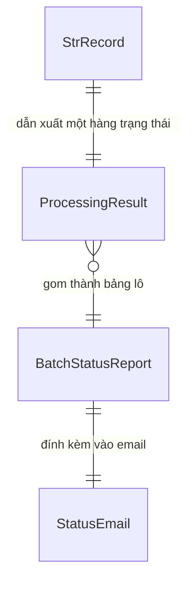

# Functional Spec — U5 TongHopVaGuiMail

Đặc tả hành vi của cấu phần U5. Đây là nguồn chân lý cho workflow và state machine
của U5; ER diagram và rules summary bên dưới là view dẫn xuất. U5 là chặng cuối
pipeline, chạy một lần cho cả lô sau khi mọi CIF đã qua U1–U4.

## Workflow chính — tổng hợp và gửi email trạng thái lô

1. Nhận tập `StrRecord` của tất cả CIF trong lô (gồm cả record đã dừng luồng từ
   U1–U4).
2. Với mỗi `StrRecord`, dựng một `ProcessingResult` (BR5.1): status = FAIL nếu
   `processingStopped = true` hoặc có `BOT_*` lỗi; ngược lại SUCCESS. Lấy
   `errorCode`/`errorDetail` từ `BOT_GHICHU`. KH lỗi vẫn được một hàng (BR5.5).
3. Đánh STT theo thứ tự; dựng `BatchStatusReport` — file excel trạng thái với các
   cột STT, STR_CIF, Trạng thái, Mã lỗi, Chi tiết lỗi (BR5.2).
4. Dựng `StatusEmail` (BR5.3): From = nguyendinhhai1996@hotmail.com, To =
   `EMAIL_NGUOI_LAP_BAO_CAO`, Cc = nguyendinhhai1996@hotmail.com (và Cc bổ sung
   nếu cấu hình), đính kèm file excel, tiêu đề/nội dung theo template mục 5.4.
   Thông tin mail đọc từ `data/config.yaml` (BR5.7).
5. Gửi email qua hệ thống mail exchange (BR5.3). Email này đã bao gồm trạng thái
   FAIL của các KH thất bại sau 3 lần retry (BR5.4).
6. Nếu gửi email lỗi: ghi log lỗi gửi; không làm hỏng `BatchStatusReport` đã dựng.
7. Ghi `sentAt` khi gửi thành công; kết thúc lô.

## State machine — BatchJob trong phạm vi U5

## ER diagram (derived từ entities.md)

## Rules summary (derived từ rules.md)

| ID | Loại | Nội dung |
|---|---|---|
| BR5.1 | policy | Tổng hợp trạng thái mọi CIF (gồm KH lỗi) |
| BR5.2 | constraint | Bảng trạng thái đúng cột |
| BR5.3 | policy | Gửi email lô kèm file đính kèm |
| BR5.4 | policy | KH lỗi sau 3 retry nằm trong email lô |
| BR5.5 | policy | Cô lập lỗi theo khách hàng |
| BR5.6 | constraint | Lưu vết xử lý từng bước |
| BR5.7 | constraint | Không hardcode credentials mail |

## Business scenarios

- **Lô toàn SUCCESS:** mọi CIF status = SUCCESS → bảng trạng thái không có mã lỗi
  → gửi email lô kèm file excel → `sentAt` ghi nhận.
- **Lô có KH lỗi (cô lập):** một số CIF status = FAIL với mã lỗi/chi tiết, các CIF
  khác SUCCESS → tất cả vẫn nằm trong một email lô (BR5.5).
- **KH thất bại sau 3 lần retry:** CIF đó status = FAIL, errorDetail từ `BOT_GHICHU`
  của U4; không có robot thứ hai (BR5.4).
- **Record dừng luồng từ U1/U2/U3/U4:** vẫn có một hàng FAIL với mã lỗi tương ứng.
- **Lỗi gửi email:** `BatchStatusReport` đã dựng được giữ lại; ghi log lỗi gửi để
  xử lý thủ công/chạy lại.
