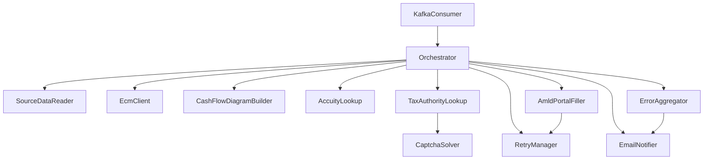
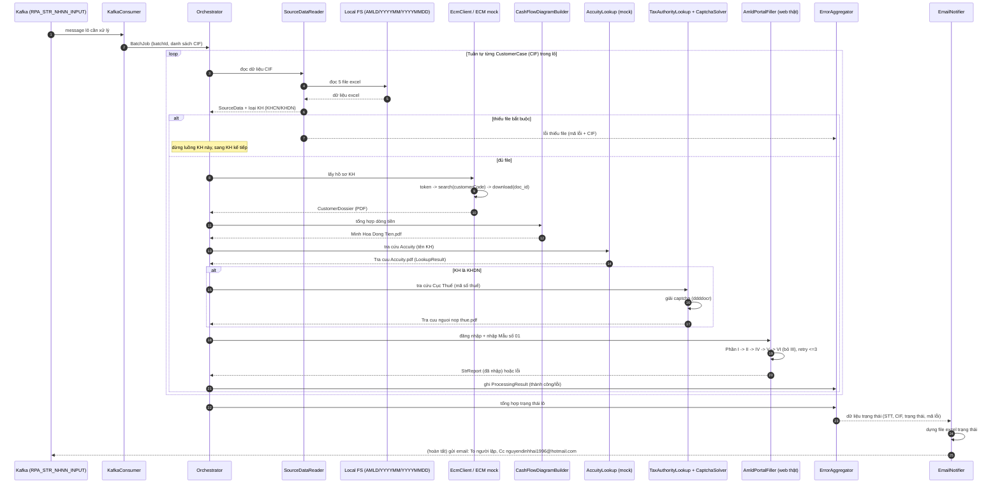

# Domain Design — Component Catalogue

Các khối logic (component) của robot RPA nhập liệu STR. Hạ tầng (Kafka, ECM mock,
các web ngoài, mail exchange, file system) là `external_dependencies`, không phải
component.

## Part A — Component catalogue (source of truth)

```yaml
components:
  - name: Orchestrator
    summary: Điều phối toàn bộ chu trình xử lý lô và từng khách hàng.
    behaviour: >
      Nhận BatchJob từ KafkaConsumer, duyệt tuần tự từng CustomerCase trong lô,
      gọi các component theo đúng thứ tự nghiệp vụ (đọc dữ liệu, lấy hồ sơ, tổng
      hợp dòng tiền, tra cứu, nhập portal), cô lập lỗi theo KH, và kích hoạt tổng
      hợp trạng thái + gửi email cuối lô. Xử lý tuần tự từng KH.
    responsibilities:
      - Quản lý vòng đời xử lý lô và từng khách hàng
      - Quyết định rẽ nhánh KHCN/KHDN
      - Cô lập lỗi: lỗi một KH không dừng cả lô
    depends_on:
      - component: KafkaConsumer
        interaction: Nhận tín hiệu lô cần xử lý
        style: async
      - component: SourceDataReader
        interaction: Đọc & kiểm tra dữ liệu nguồn của KH
        style: sync
      - component: EcmClient
        interaction: Lấy hồ sơ PDF của KH
        style: sync
      - component: CashFlowDiagramBuilder
        interaction: Tạo sơ đồ dòng tiền
        style: sync
      - component: AccuityLookup
        interaction: Tra cứu Accuity
        style: sync
      - component: TaxAuthorityLookup
        interaction: Tra cứu Cục Thuế (KHDN)
        style: sync
      - component: AmldPortalFiller
        interaction: Nhập Mẫu số 01 lên AMLD Portal
        style: sync
      - component: ErrorAggregator
        interaction: Ghi nhận trạng thái/lỗi theo KH
        style: sync
      - component: EmailNotifier
        interaction: Gửi email trạng thái lô
        style: sync
    dependents: []
    entities:
      - name: BatchJob
        identifier: batchId
        attributes: [batchId, batchDate, customerCaseRefs, receivedAt]
      - name: CustomerCase
        identifier: cif
        attributes: [cif, customerType, status, sourceFolderPath]
        references:
          - entity: BatchJob
            owned_by: Orchestrator
            relationship: mỗi CustomerCase thuộc một BatchJob

  - name: KafkaConsumer
    summary: Consumer Kafka, chuyển message thành BatchJob.
    behaviour: >
      Lắng nghe topic RPA_STR_NHNN_INPUT tại localhost:9092 (PLAINTEXT, không
      user/pass), parse message thành BatchJob; message không hợp lệ được ghi log
      và bỏ qua mà không dừng consumer.
    responsibilities:
      - Kết nối & tiêu thụ message từ Kafka
      - Chuyển message hợp lệ thành BatchJob cho Orchestrator
    depends_on: []
    dependents:
      - component: Orchestrator
        interaction: Bàn giao BatchJob đã parse
    external_dependencies:
      - name: Kafka
        kind: queue
        purpose: Nguồn kích hoạt việc (topic RPA_STR_NHNN_INPUT)
    entities: []

  - name: SourceDataReader
    summary: Đọc và kiểm tra 5 file excel nguồn trong folder CIF.
    behaviour: >
      Nhận diện folder theo ngày (/Users/hainguyen/Projects/RPA/AMLD/YYYYMM/YYYYMMDD),
      đọc 5 file excel bắt buộc của một CIF, xác định loại KH (KHCN/KHDN), kiểm tra
      đủ file; thiếu file thì báo lỗi và dừng luồng KH đó.
    responsibilities:
      - Đọc dữ liệu excel nguồn
      - Kiểm tra đủ file bắt buộc
      - Xác định loại khách hàng (KHCN/KHDN)
    depends_on: []
    dependents:
      - component: Orchestrator
        interaction: Cung cấp SourceData và loại KH
    external_dependencies:
      - name: Local file system
        kind: object-store
        purpose: Thư mục nguồn chứa 5 file excel theo ngày/CIF
    entities:
      - name: SourceData
        identifier: cif
        attributes: [cif, customerType, inputStrRow, individualRows, orgRows, suspiciousTxnRows, statementRows]
        references:
          - entity: CustomerCase
            owned_by: Orchestrator
            relationship: SourceData thuộc một CustomerCase

  - name: EcmClient
    summary: Lấy file PDF hồ sơ khách hàng qua ECM mock API.
    behaviour: >
      Gọi ECM mock http://localhost:8831: lấy token (client_credentials) →
      search file theo customerCode → tải PDF theo doc_id. Credentials đọc từ cấu
      hình/biến môi trường. Lỗi hoặc thiếu hồ sơ bắt buộc thì báo lỗi.
    responsibilities:
      - Xác thực và gọi ECM mock
      - Tải và lưu các file PDF hồ sơ KH
    depends_on: []
    dependents:
      - component: Orchestrator
        interaction: Cung cấp CustomerDossier (các file PDF)
    external_dependencies:
      - name: ECM mock server
        kind: third-party-api
        purpose: Nguồn hồ sơ PDF khách hàng (localhost:8831)
    entities:
      - name: CustomerDossier
        identifier: cif
        attributes: [cif, pdfFiles, docIds, retrievedAt]
        references:
          - entity: CustomerCase
            owned_by: Orchestrator
            relationship: CustomerDossier thuộc một CustomerCase

  - name: CashFlowDiagramBuilder
    summary: Tính và vẽ sơ đồ dòng tiền, xuất PDF.
    behaviour: >
      Từ bảng kê GD, tính shape tiền vào (HUONG_GD=C) và tiền ra (HUONG_GD=D) và
      tên ĐTBC, vẽ sơ đồ và lưu Minh Họa Dòng Tiền.pdf.
    responsibilities:
      - Tính toán số liệu dòng tiền
      - Dựng và xuất file PDF minh họa
    depends_on: []
    dependents:
      - component: Orchestrator
        interaction: Cung cấp CashFlowDiagram
    entities:
      - name: CashFlowDiagram
        identifier: cif
        attributes: [cif, inflowSummary, outflowSummary, reportSubjectName, pdfPath]
        references:
          - entity: CustomerCase
            owned_by: Orchestrator
            relationship: CashFlowDiagram thuộc một CustomerCase

  - name: AccuityLookup
    summary: Tra cứu khách hàng trên web Accuity (mock) và xuất PDF kết quả.
    behaviour: >
      Qua AccuityAdapter, đăng nhập web Accuity mock, chọn Entity Type theo loại
      KH, tra cứu theo tên, export Tra cứu Accuity.pdf; Match Score 100 thì print
      thêm hồ sơ. Lỗi đăng nhập/thao tác thì báo lỗi.
    responsibilities:
      - Tra cứu Accuity theo loại KH và tên
      - Xuất PDF kết quả tra cứu
    depends_on: []
    dependents:
      - component: Orchestrator
        interaction: Cung cấp LookupResult (Accuity)
    external_dependencies:
      - name: Accuity mock web
        kind: third-party-api
        purpose: Web mock tra cứu danh sách cảnh báo
    entities:
      - name: LookupResult
        identifier: lookupId
        attributes: [lookupId, cif, source, matchScore, resultPdfPaths]
        references:
          - entity: CustomerCase
            owned_by: Orchestrator
            relationship: LookupResult thuộc một CustomerCase

  - name: TaxAuthorityLookup
    summary: Tra cứu tình trạng người nộp thuế trên web Cục Thuế (chỉ KHDN).
    behaviour: >
      Qua TaxAuthorityAdapter, chỉ chạy khi KHDN; mở web Cục Thuế thật, nhập mã số
      thuế, giải captcha bằng ddddocr, print Tra cứu tình trạng người nộp thuế.pdf
      khi có kết quả; không có kết quả thì bỏ qua; lỗi thì báo lỗi.
    responsibilities:
      - Tra cứu Cục Thuế cho KHDN
      - Giải captcha bằng ddddocr
    depends_on:
      - component: CaptchaSolver
        interaction: Giải captcha ảnh bằng ddddocr
        style: sync
    dependents:
      - component: Orchestrator
        interaction: Cung cấp LookupResult (Cục Thuế)
    external_dependencies:
      - name: Tax Authority web
        kind: third-party-api
        purpose: Web thật tra cứu người nộp thuế
    entities: []

  - name: CaptchaSolver
    summary: Giải captcha ảnh bằng ddddocr.
    behaviour: >
      Nhận ảnh captcha, trả về chuỗi nhận dạng dùng framework ddddocr; có giới hạn
      số lần thử (chốt ở thiết kế).
    responsibilities:
      - Nhận dạng ký tự captcha từ ảnh
    depends_on: []
    dependents:
      - component: TaxAuthorityLookup
        interaction: Cung cấp chuỗi captcha đã giải
    external_dependencies:
      - name: ddddocr
        kind: third-party-api
        purpose: Thư viện OCR captcha
    entities: []

  - name: AmldPortalFiller
    summary: Đăng nhập AMLD Portal và nhập Mẫu số 01, đính kèm tài liệu.
    behaviour: >
      Qua AmldPortalAdapter, đăng nhập AMLD Portal thật (reload tối đa 3 lần nếu
      treo), nhập Phần I/II/IV/V/VI theo thứ tự, KHÔNG điền Phần III, rẽ nhánh
      KHCN/KHDN ở Phần II, áp quy tắc Phần V (6/7/8 thì thêm 4,5), chặn giá trị
      tick ngoài định nghĩa, upload tài liệu Phần VI đúng thứ tự.
    responsibilities:
      - Đăng nhập và điều hướng AMLD Portal
      - Nhập đầy đủ các Phần của Mẫu số 01
      - Đính kèm tài liệu theo thứ tự
      - Chặn giá trị tick ngoài định nghĩa
    depends_on: []
    dependents:
      - component: Orchestrator
        interaction: Thực hiện nhập báo cáo cho một KH
    external_dependencies:
      - name: AMLD Online Portal
        kind: third-party-api
        purpose: Cổng nhập báo cáo STR thật của NHNN
    entities:
      - name: StrReport
        identifier: cif
        attributes: [cif, sectionsFilled, attachmentsUploaded, submittedAt]
        references:
          - entity: CustomerCase
            owned_by: Orchestrator
            relationship: StrReport thuộc một CustomerCase

  - name: RetryManager
    summary: Chính sách retry cho các bước nhập/tương tác dễ lỗi.
    behaviour: >
      Bọc một thao tác dễ lỗi, thử lại tối đa 3 lần; vẫn lỗi thì phát tín hiệu
      thất bại để Orchestrator ghi nhận và kích hoạt email báo lỗi.
    responsibilities:
      - Áp chính sách retry (<=3 lần)
      - Báo hiệu khi vượt ngưỡng
    depends_on: []
    dependents:
      - component: Orchestrator
        interaction: Cung cấp cơ chế retry cho các bước
      - component: AmldPortalFiller
        interaction: Bọc retry cho các bước nhập Phần
    entities: []

  - name: ErrorAggregator
    summary: Tổng hợp trạng thái và lỗi theo từng khách hàng trong lô.
    behaviour: >
      Thu thập kết quả xử lý từng KH (thành công/lỗi, mã lỗi, chi tiết, CIF), dựng
      ProcessingResult và tổng hợp cấp lô để EmailNotifier dùng.
    responsibilities:
      - Ghi nhận kết quả/lỗi theo KH
      - Dựng dữ liệu trạng thái cấp lô
    depends_on: []
    dependents:
      - component: Orchestrator
        interaction: Nhận và lưu kết quả theo KH
      - component: EmailNotifier
        interaction: Cung cấp dữ liệu trạng thái lô
    entities:
      - name: ProcessingResult
        identifier: cif
        attributes: [cif, status, errorCode, errorDetail]
        references:
          - entity: CustomerCase
            owned_by: Orchestrator
            relationship: ProcessingResult thuộc một CustomerCase

  - name: EmailNotifier
    summary: Dựng file trạng thái và gửi email thông báo lô.
    behaviour: >
      Dựng file excel trạng thái (STT, STR_CIF, Trạng thái, Mã lỗi, Chi tiết lỗi),
      gửi email qua mail exchange: From/Cc nguyendinhhai1996@hotmail.com, To người
      lập báo cáo, theo template tiêu đề/nội dung.
    responsibilities:
      - Dựng BatchStatusReport (file đính kèm)
      - Gửi email trạng thái lô
    depends_on: []
    dependents:
      - component: Orchestrator
        interaction: Gửi email cuối lô
    external_dependencies:
      - name: Mail exchange
        kind: third-party-api
        purpose: Gửi email trạng thái/cảnh báo lỗi
    entities:
      - name: BatchStatusReport
        identifier: batchId
        attributes: [batchId, rows, attachmentPath, sentAt]
        references:
          - entity: BatchJob
            owned_by: Orchestrator
            relationship: BatchStatusReport tổng hợp cho một BatchJob
```

## Part B — Human-readable view

### Component Diagram



### Data Flow (sequence)

Luồng dữ liệu end-to-end khi xử lý một lô (tuần tự từng khách hàng):



### Component Summary

| Component | Purpose | Depends On | Dependents | Entities Owned |
|---|---|---|---|---|
| Orchestrator | Điều phối lô/KH | KafkaConsumer, SourceDataReader, EcmClient, CashFlowDiagramBuilder, AccuityLookup, TaxAuthorityLookup, AmldPortalFiller, ErrorAggregator, EmailNotifier | — | BatchJob, CustomerCase |
| KafkaConsumer | Nhận việc từ Kafka | — | Orchestrator | — |
| SourceDataReader | Đọc & kiểm tra 5 file excel | — | Orchestrator | SourceData |
| EcmClient | Lấy PDF hồ sơ qua ECM mock | — | Orchestrator | CustomerDossier |
| CashFlowDiagramBuilder | Tổng hợp & vẽ dòng tiền | — | Orchestrator | CashFlowDiagram |
| AccuityLookup | Tra cứu Accuity (mock) | — | Orchestrator | LookupResult |
| TaxAuthorityLookup | Tra cứu Cục Thuế (KHDN) | CaptchaSolver | Orchestrator | — |
| CaptchaSolver | Giải captcha ddddocr | — | TaxAuthorityLookup | — |
| AmldPortalFiller | Nhập Mẫu số 01 trên AMLD | — | Orchestrator | StrReport |
| RetryManager | Chính sách retry <=3 | — | Orchestrator, AmldPortalFiller | — |
| ErrorAggregator | Tổng hợp lỗi theo KH | — | Orchestrator, EmailNotifier | ProcessingResult |
| EmailNotifier | Dựng file + gửi email lô | — | Orchestrator | BatchStatusReport |

### Entity Ownership

| Entity | Owning Component | Identifier | Attributes | References |
|---|---|---|---|---|
| BatchJob | Orchestrator | batchId | batchId, batchDate, customerCaseRefs, receivedAt | — |
| CustomerCase | Orchestrator | cif | cif, customerType, status, sourceFolderPath | BatchJob |
| SourceData | SourceDataReader | cif | cif, customerType, inputStrRow, individualRows, orgRows, suspiciousTxnRows, statementRows | CustomerCase |
| CustomerDossier | EcmClient | cif | cif, pdfFiles, docIds, retrievedAt | CustomerCase |
| CashFlowDiagram | CashFlowDiagramBuilder | cif | cif, inflowSummary, outflowSummary, reportSubjectName, pdfPath | CustomerCase |
| LookupResult | AccuityLookup | lookupId | lookupId, cif, source, matchScore, resultPdfPaths | CustomerCase |
| StrReport | AmldPortalFiller | cif | cif, sectionsFilled, attachmentsUploaded, submittedAt | CustomerCase |
| ProcessingResult | ErrorAggregator | cif | cif, status, errorCode, errorDetail | CustomerCase |
| BatchStatusReport | EmailNotifier | batchId | batchId, rows, attachmentPath, sentAt | BatchJob |

### External Dependencies

| Component | Dependency | Kind | Purpose |
|---|---|---|---|
| KafkaConsumer | Kafka | queue | Nguồn kích hoạt việc (topic RPA_STR_NHNN_INPUT) |
| SourceDataReader | Local file system | object-store | Thư mục nguồn 5 file excel theo ngày/CIF |
| EcmClient | ECM mock server | third-party-api | Hồ sơ PDF khách hàng (localhost:8831) |
| AccuityLookup | Accuity mock web | third-party-api | Tra cứu danh sách cảnh báo |
| TaxAuthorityLookup | Tax Authority web | third-party-api | Tra cứu người nộp thuế (thật) |
| CaptchaSolver | ddddocr | third-party-api | OCR captcha |
| AmldPortalFiller | AMLD Online Portal | third-party-api | Cổng nhập báo cáo STR thật |
| EmailNotifier | Mail exchange | third-party-api | Gửi email trạng thái/cảnh báo |

### Rationale

| Component | Vì sao là khối riêng |
|---|---|
| Orchestrator | Vòng đời điều phối riêng; giữ logic rẽ nhánh và cô lập lỗi tách khỏi thao tác cụ thể |
| KafkaConsumer | Quan tâm hạ tầng messaging, nhịp thay đổi riêng (có thể đổi broker/giao thức) |
| SourceDataReader | Logic đọc/kiểm tra file excel tách biệt, dễ test với fixtures |
| EcmClient | Tích hợp API ECM riêng, cần mock trong test |
| CashFlowDiagramBuilder | Thuần tính toán + render PDF, test độc lập theo số liệu |
| AccuityLookup / TaxAuthorityLookup | Mỗi web ngoài một tích hợp riêng, mock/real khác nhau |
| CaptchaSolver | Tách để thay đổi/thử nghiệm giải captcha độc lập |
| AmldPortalFiller | Khối phức tạp nhất (nhiều Phần), thay đổi khi portal đổi giao diện |
| RetryManager | Cross-cutting policy, dùng chung nhiều nơi |
| ErrorAggregator | Tập trung logic tổng hợp lỗi/trạng thái, tách khỏi xử lý |
| EmailNotifier | Quan tâm thông báo, tách khỏi logic nghiệp vụ |

**Alternatives Rejected:** Gộp thô (DataIngestion/ExternalLookups/PortalAutomation)
làm giảm khả năng test độc lập và mock từng hệ thống ngoài (NFR6); tách mịn từng
Phần của Mẫu số 01 thành component riêng gây phân mảnh không cần thiết — các Phần
dùng chung session/trình duyệt nên thuộc cùng AmldPortalFiller.
