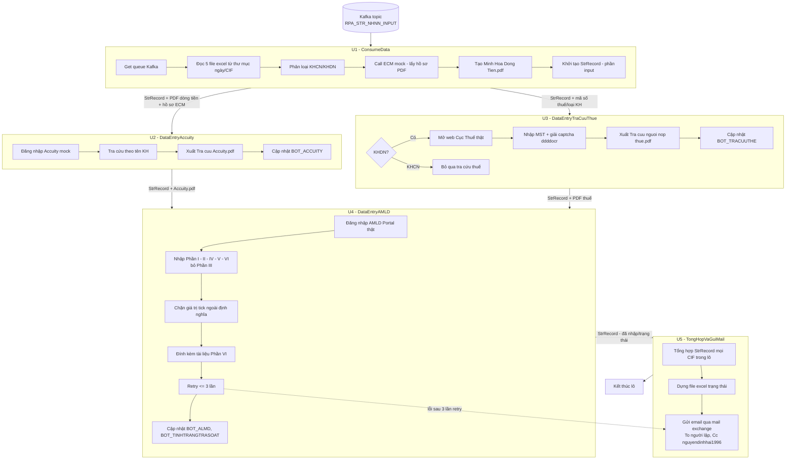

# Unit Dependency DAG

5 cấu phần với một nhánh song song: U1 trước, rồi U2 (Accuity) và U3 (Cục Thuế)
độc lập chạy song song, U4 hội tụ cả hai, U5 cuối. Dữ liệu truyền là object
`StrRecord` theo CIF. Đây là topology, không phải thứ tự thi công kinh tế.

## DAG (prose)

- **U1 (ConsumeData)** — không phụ thuộc Unit nào. Nhận Kafka, đọc excel, phân
  loại KH, call ECM, tạo file dòng tiền; khởi tạo `StrRecord`.
- **U2 (DataEntryAccuity)** depends on **U1** — cần `StrRecord` (tên KH, loại KH).
- **U3 (DataEntryTraCuuThue)** depends on **U1** — chỉ cần mã số thuế + loại KH từ
  U1; độc lập với U2 (chỉ xử lý thực khi KHDN). Có thể chạy song song với U2.
- **U4 (DataEntryAMLD)** depends on **U2 và U3** — điểm hội tụ: cần cả kết quả tra
  cứu Accuity (U2) và kết quả tra cứu thuế (U3), cùng các file đính kèm, để nhập
  AMLD.
- **U5 (TongHopVaGuiMail)** depends on **U4** — tổng hợp `StrRecord` của cả lô và
  gửi email.

### Điểm tích hợp giữa các Unit

- Hợp đồng dữ liệu chung giữa mọi cấu phần là object `StrRecord` (xem
  unit-of-work.md). Mỗi cấu phần bồi đắp các cột thuộc trách nhiệm của mình.
- U1 → U2: `StrRecord` (phần input) + file dòng tiền + hồ sơ ECM.
- U1 → U3: `StrRecord` (mã số thuế + loại KH).
- U2 → U4: `StrRecord` (+ BOT_ACCUITY) + `Tra cứu Accuity.pdf`.
- U3 → U4: `StrRecord` (+ BOT_TRACUUTHE) + PDF tra cứu thuế (nếu có).
- U4 → U5: `StrRecord` (+ BOT_ALMD, BOT_TINHTRANGTRASOAT, BOT_GHICHU).

### Phát triển song song

Sau khi U1 xong, **U2 (Accuity) và U3 (Cục Thuế) độc lập với nhau** — cả hai chỉ
cần output của U1 (tên KH, loại KH, mã số thuế), không cần output của nhau. Chúng
là hai nhánh tra cứu riêng và tạo thành một **batch chạy song song** sau U1. U4
hội tụ cả hai. Hợp đồng `StrRecord` (mỗi cấu phần ghi cột riêng: U2 ghi
BOT_ACCUITY, U3 ghi BOT_TRACUUTHE) đảm bảo hai nhánh không ghi đè nhau khi hợp
nhất.

### Walking skeleton

Không áp dụng cho phân rã này: không có Unit skeleton riêng. Mỗi cấu phần là một
chặng xử lý thực của pipeline; lát cắt chạy được sớm nhất là U1 (ConsumeData) tạo
`StrRecord` và file dòng tiền.

## Pipeline flow (mermaid)



## Edge block (machine-readable)

```yaml
units:
  - name: u1-consume-data
    kind: service
    depends_on: []
  - name: u2-data-entry-accuity
    kind: service
    depends_on: [u1-consume-data]
  - name: u3-data-entry-tracuuthue
    kind: service
    depends_on: [u1-consume-data]
  - name: u4-data-entry-amld
    kind: service
    depends_on: [u2-data-entry-accuity, u3-data-entry-tracuuthue]
  - name: u5-tonghop-guimail
    kind: service
    depends_on: [u4-data-entry-amld]
```
